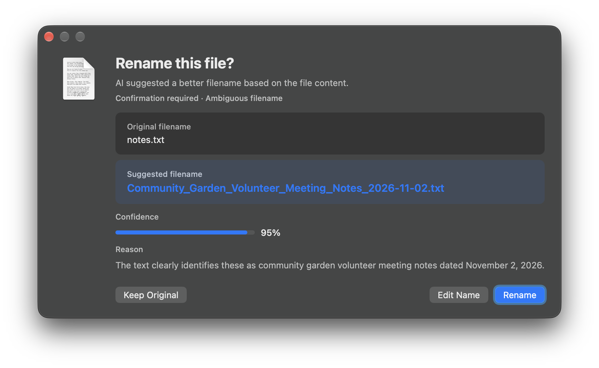

# Auto Filename Helper

[English](README.md)

供 Finder 快捷指令调用的原生 macOS 文件命名助手。快捷指令先判断原名是否需要改善，再由模型给出有依据的名称；应用负责校验、保留扩展名、确认高风险操作，并避免覆盖已有文件。

## 安装与使用

1. 下载或克隆仓库。构建应用需要 macOS 13 或更新版本及 Xcode Command Line Tools。
2. 运行 **Install.command**，或在项目目录用 zsh 执行 **build_and_install.sh**。应用会安装到当前用户的 Applications 文件夹，名称为 **AutoFilenameHelper.app**。
3. 下载并打开 [Auto Filename.shortcut](https://github.com/Jingyuan-Zheng/AutoFilenameHelper/raw/refs/heads/main/Auto%20Filename.shortcut)，检查动作后添加到“快捷指令”。默认安装位置已接好，无需修改用户名或个人路径。
4. 完整快捷指令需要支持 **Use Model（使用模型）** 动作的 Mac 与 macOS，并已启用 Apple Intelligence、可使用 ChatGPT 模型。辅助应用支持 macOS 13，不代表 AI 快捷指令也支持 macOS 13；请在快捷指令中检查模型选择和权限提示。
5. 先在 Finder 选中一个文件副本，运行 **快速操作 → Auto Filename**。若菜单没有显示，在快捷指令详情中启用 Finder；若 macOS 提示，请允许快捷指令运行脚本。
6. 出现确认窗口时检查建议。高置信度结果可按设置自动改名；原名已经有明确含义时，工作流会主动跳过。

导入前若已有同名旧快捷指令，请先将旧版移除或改名。直接打开辅助应用只会显示设置，不会自动生成文件名。

## 功能

- 默认保留扩展名，不覆盖已有文件。
- 拒绝不安全名称、符号链接、不支持的源文件类型和没有变化的名称。
- 名称含糊、置信度低、可执行文件或关闭自动改名时，可要求确认。
- 支持 Quick Look、在 Finder 中显示、复制路径、重名策略、外观设置和中英文界面。
- 启动步骤使用当前用户的主目录，应用未安装时会报错；如自定义安装位置，修改最后一个 Shell 动作。

## 详细教程与排错

[博客完整教程、关键脚本与模型提示词](https://jingyuan.is-a.dev/zh/p/auto-filename-helper/)介绍输入协议、没有改名时的排查方法，以及本次模型提示词接线修复；另有 [English guide](https://jingyuan.is-a.dev/p/auto-filename-helper/)。

仓库同时提供可编辑的[快捷指令源文件](Shortcut/Auto%20Filename.xml)、[Shell 脚本](Shortcut/scripts/)和[提示词文件](Shortcut/prompts/)，便于检查和修改。签名文件可直接导入；修改源文件后需要重新签名，步骤见博客。

## 隐私与许可证

辅助应用本身不发起网络请求。快捷指令使用 Apple Intelligence 判断文件名、使用 ChatGPT 生成建议，可能向所选模型服务传递有长度限制的文本、元数据和支持的图片；模型动作也允许网页搜索。处理私人文档前，请检查工作流与服务设置。模型给出的置信度不是独立验证的准确率。

项目源码、快捷指令、脚本、提示词和文档采用 [MIT 许可证](LICENSE)。构建时从 macOS 本机取用的 Finder 图标等 Apple 系统资源，以及第三方服务，仍受各自条款约束。
